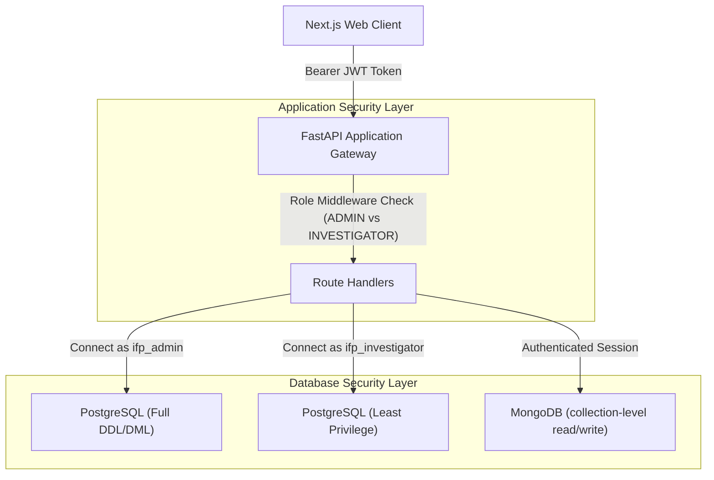

# Intelligence Fusion Platform — Authorization & Access Control (RBAC)

**Course:** Database Management Systems Mini Project (UE24CS395/DBMS)  
**Authors:** Saatvik Gupta (`PES1UG24CS395`) & Satyam Goyal (`PES1UG24CS424`)  
**Security Model:** Defense-in-Depth Role-Based Access Control (RBAC)  

---

## 1. Dual-Layer Security Model

The Intelligence Fusion Platform implements a defense-in-depth security model operating at two independent architectural boundaries:
1. **Application-Level RBAC (FastAPI & Next.js):** Enforces user session authentication, JSON Web Token (JWT) verification, endpoint route protection, and UI feature gates.
2. **Database-Level RBAC (PostgreSQL & MongoDB):** Enforces the principle of least privilege directly within the database engines, ensuring that even if application server credentials are compromised, database permissions cannot be exceeded.



---

## 2. Role Definitions & Permissions Matrix

The system mandates two primary roles: **`ADMIN`** and **`INVESTIGATOR`** (with optional support for `ANALYST` and `AUDITOR`):

| Operation / Resource | ADMIN Role | INVESTIGATOR Role | Database Enforcement Mechanism |
|----------------------|------------|-------------------|--------------------------------|
| **User & Officer Management** | Full CRUD | Read-Only | PostgreSQL `REVOKE INSERT, UPDATE, DELETE ON users, officers` |
| **Case Initialization** | Create, Update, Close | Create, Update (Assigned) | PostgreSQL `GRANT INSERT, UPDATE ON cases` |
| **Case Deletion** | Allowed (with audit) | **FORBIDDEN** | PostgreSQL `REVOKE DELETE ON cases` |
| **Evidence Registration** | Create, Update | Create, Update | PostgreSQL `GRANT INSERT, UPDATE ON evidence` |
| **Evidence Destruction / Deletion** | Restricted to Evidence Custodian | **STRICTLY FORBIDDEN** | PostgreSQL `REVOKE DELETE ON evidence` |
| **Chain of Custody Modifications** | Append-Only (Insert) | Append-Only (Insert) | PostgreSQL `REVOKE UPDATE, DELETE ON evidence_custody` |
| **Audit Log Deletion** | **FORBIDDEN (Immutable)** | **FORBIDDEN (Immutable)** | PostgreSQL `REVOKE DELETE ON case_activity` |
| **Unstructured Document Ingestion** | Ingest, Tag, Classify | Ingest, Tag, Classify | MongoDB `readWrite` on `investigation_documents` |
| **System Settings & DDL Migrations** | Full Superuser Access | **FORBIDDEN** | Schema ownership reserved for migration admin |

---

## 3. Database-Level Role Implementation (PostgreSQL)

Configured via [`database/sql/roles-and-grants.sql`](file:///d:/DBMS%20Mini%20Project/database/sql/roles-and-grants.sql):

```sql
-- Role Creation
CREATE ROLE ifp_admin WITH LOGIN PASSWORD 'Admin@SecPass2026';
CREATE ROLE ifp_investigator WITH LOGIN PASSWORD 'Investigator@SecPass2026';

-- Granting ifp_investigator controlled operational access
GRANT SELECT, INSERT, UPDATE ON 
    cases, people, organizations, vehicles, devices, locations, evidence,
    case_people, case_organizations, case_vehicles, case_devices, case_locations
TO ifp_investigator;

-- Read-only on personnel
GRANT SELECT ON users, officers TO ifp_investigator;

-- Append-only on custody audit logs (cannot modify or erase historical handoffs)
GRANT SELECT, INSERT ON case_activity, evidence_custody TO ifp_investigator;

-- Explicit denial of deletion capabilities to preserve evidentiary integrity
REVOKE DELETE ON cases, evidence, evidence_custody, case_activity FROM ifp_investigator;
```

---

## 4. Application-Level RBAC Implementation (FastAPI)

In [`backend/app/routers/auth.py`](file:///d:/DBMS%20Mini%20Project/backend/app/routers/auth.py), endpoints enforce claims-based authorization via FastAPI dependency injection:

```python
from fastapi import Depends, HTTPException, status
from fastapi.security import OAuth2PasswordBearer
from jose import jwt, JWTError

def require_role(allowed_roles: list[str]):
    def role_checker(current_user: dict = Depends(get_current_active_user)):
        if current_user.get("role") not in allowed_roles:
            raise HTTPException(
                status_code=status.HTTP_403_FORBIDDEN,
                detail=f"Access Denied: Requires one of {allowed_roles} roles."
            )
        return current_user
    return role_checker

# Example usage:
# @router.delete("/cases/{case_id}", dependencies=[Depends(require_role(["ADMIN"]))])
# @router.post("/cases", dependencies=[Depends(require_role(["ADMIN", "INVESTIGATOR"]))])
```

---

## 5. MongoDB Access Control

In MongoDB production deployments:
```javascript
// Administrator user
db.createUser({
  user: "ifp_mongo_admin",
  pwd: "MongoAdminPassword2026",
  roles: [ { role: "dbOwner", db: "intelligence_fusion" } ]
});

// Investigator application user
db.createUser({
  user: "ifp_mongo_app",
  pwd: "MongoAppPassword2026",
  roles: [
    { role: "readWrite", db: "intelligence_fusion" }
  ]
});
```

---

## 6. Audit & Non-Repudiation

Every sensitive operation executed within the system records the performing agent's `officer_id` and timestamp. The database trigger `trg_case_activity_audit` ensures that status updates produce an immutable record in `case_activity` that cannot be forged or bypassed by application code.
