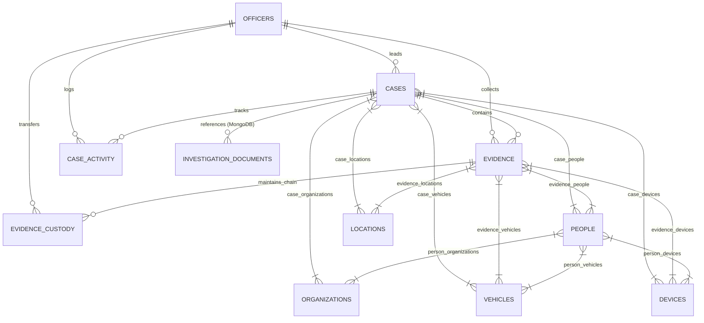

# Database Design & Architecture Document

**Project Title:** Intelligence Fusion Platform  
**Project Type:** DBMS Mini Project  
**Team Members:**  
- **Saatvik Gupta** — PES1UG24CS395  
- **Satyam Goyal** — PES1UG24CS424  

---

## 1. System Overview

The **Intelligence Fusion Platform** combines a normalized relational database (PostgreSQL) with a polymorphic document database (MongoDB) to manage investigation intelligence.

- **PostgreSQL (Relational Store):** Serves as the strict system of record for structured entities, foreign key referential integrity, Many-to-Many bridge tables, and chronological audit logs.
- **MongoDB (Document Store):** Stores heterogenous, semi-structured, and polymorphic investigation documents (witness statements, CCTV telemetry, chat dumps, sensor logs) that require schema flexibility and rapid full-text search.

---

## 2. Entity-Relationship (ER) Diagram



---

## 3. Relational Schema & Tables

### Primary Entity Tables (11 Tables)
1. **`officers`**: Primary key `officer_id`. Stores credentials (`hashed_password`), badge identifier (`badge_number`), department, and role.
2. **`cases`**: Primary key `case_id` (`CASE-YYYY-XXX`). Foreign key `lead_officer_id` references `officers.officer_id`. Check constraints enforce valid statuses (`Open`, `Under Investigation`, `On Hold`, `Closed`) and priorities (`Low`, `Medium`, `High`, `Critical`).
3. **`people`**: Primary key `person_id`. Stores demographic and category attributes (`Witness`, `Reporting Party`, `Subject`, `Other`).
4. **`organizations`**: Primary key `organization_id`. Stores commercial, governmental, and corporate entities.
5. **`vehicles`**: Primary key `vehicle_id`. Unique constraint on `registration_number`.
6. **`devices`**: Primary key `device_id`. Unique constraint on `serial_number`.
7. **`locations`**: Primary key `location_id`. Stores latitude, longitude, and physical addresses.
8. **`evidence`**: Primary key `evidence_id`. Foreign key `case_id` references `cases.case_id`.
9. **`evidence_custody`**: Primary key `custody_event_id` (autoincrement). Foreign keys reference `evidence.evidence_id` and `officers.officer_id`.
10. **`case_activity`**: Primary key `activity_id` (autoincrement). Logs timeline events.

### Many-to-Many Junction Tables (11 Bridge Tables)
- `case_people` (case_id, person_id, role_in_case, notes, added_at)
- `case_organizations` (case_id, organization_id, association_type, added_at)
- `case_vehicles` (case_id, vehicle_id, role_in_case, added_at)
- `case_devices` (case_id, device_id, role_in_case, added_at)
- `case_locations` (case_id, location_id, association_type, added_at)
- `person_organizations` (person_id, organization_id, role, added_at)
- `person_vehicles` (person_id, vehicle_id, relationship_type, added_at)
- `person_devices` (person_id, device_id, relationship_type, added_at)
- `evidence_people` (evidence_id, person_id, association_type, added_at)
- `evidence_vehicles` (evidence_id, vehicle_id, association_type, added_at)
- `evidence_devices` (evidence_id, device_id, association_type, added_at)
- `evidence_locations` (evidence_id, location_id, association_type, added_at)

---

## 4. Normalization Analysis

### First Normal Form (1NF)
- All attribute values are strictly atomic. No multi-valued attributes (such as comma-separated vehicle IDs or list of phone numbers) exist inside single columns.

### Second Normal Form (2NF)
- The database satisfies 1NF.
- In all junction tables with composite primary keys (e.g. `(case_id, person_id)`), non-prime attributes like `role_in_case` and `added_at` depend fully on the complete composite key, not a partial subset.

### Third Normal Form (3NF)
- The database satisfies 2NF.
- No transitive dependencies ($X \to Y \to Z$) exist in primary entity tables. Attributes of related entities (such as an officer's department or an organization's address) are stored exclusively in their parent entity tables rather than duplicated within `cases`.

### Boyce-Codd Normal Form (BCNF)
- For every non-trivial functional dependency $X \to Y$, $X$ is a superkey.

---

## 5. MongoDB Document Architecture

**Database:** `intelligence_fusion`  
**Collection:** `investigation_documents`

### Document Schema Definition
```json
{
  "_id": "ObjectId",
  "document_type": "Witness statements | Investigation notes | Social media posts | Chat exports | Image metadata | CCTV metadata | PDF reports | Email archives | JSON API responses",
  "title": "String",
  "content": "String",
  "summary": "String",
  "source_type": "String",
  "source_name": "String",
  "created_at": "ISODate",
  "ingested_at": "ISODate",
  "case_id": "String (Optional foreign key to SQL case_id)",
  "related_entity_ids": [
    { "entity_type": "person", "entity_id": "PER-001" }
  ],
  "tags": ["String"],
  "metadata": {
    "dynamic_field_1": "Value",
    "telemetry": {}
  },
  "document_status": "Verified | Under Review | Archived"
}
```

### MongoDB Indexes
1. **Full-Text Compound Index:** `("title": "text", "content": "text", "summary": "text", "tags": "text")`
2. **Single Field Indexes:** `case_id`, `document_type`, `source_type`, `created_at`
