# Intelligence Fusion Platform — Entity-Relationship (ER) Diagram

**Course:** Database Management Systems Mini Project (UE24CS395/DBMS)  
**Authors:** Saatvik Gupta (`PES1UG24CS395`) & Satyam Goyal (`PES1UG24CS424`)  
**Domain:** Multi-Agency Investigation & Intelligence Fusion Platform  

---

## 1. Complete System Entity-Relationship Diagram (Mermaid ER)

```mermaid
erDiagram
    USERS ||--o| OFFICERS : "provisions identity"
    OFFICERS ||--o{ CASES : "leads investigation"
    OFFICERS ||--o{ EVIDENCE : "collects"
    OFFICERS ||--o{ EVIDENCE_CUSTODY : "transfers / receives"
    OFFICERS ||--o{ CASE_ACTIVITY : "performs action"

    CASES ||--o{ CASE_ACTIVITY : "audits state changes"
    CASES ||--o{ EVIDENCE : "contains exhibits"
    
    CASES ||--|{ CASE_PEOPLE : "associates"
    PEOPLE ||--|{ CASE_PEOPLE : "involved in"

    CASES ||--|{ CASE_ORGANIZATIONS : "targets / investigates"
    ORGANIZATIONS ||--|{ CASE_ORGANIZATIONS : "linked to"

    CASES ||--|{ CASE_VEHICLES : "impounds / tracks"
    VEHICLES ||--|{ CASE_VEHICLES : "implicated in"

    CASES ||--|{ CASE_DEVICES : "seizes / analyzes"
    DEVICES ||--|{ CASE_DEVICES : "linked to"

    CASES ||--|{ CASE_LOCATIONS : "maps crime scenes"
    LOCATIONS ||--|{ CASE_LOCATIONS : "geolocated in"

    CASES ||--|{ CASE_OFFICERS : "assigns taskforce"
    OFFICERS ||--|{ CASE_OFFICERS : "serves on"

    EVIDENCE ||--o{ EVIDENCE_CUSTODY : "tracked by"
    EVIDENCE ||--|{ EVIDENCE_PEOPLE : "recovered from"
    PEOPLE ||--|{ EVIDENCE_PEOPLE : "associated with"

    EVIDENCE ||--|{ EVIDENCE_VEHICLES : "recovered from"
    VEHICLES ||--|{ EVIDENCE_VEHICLES : "associated with"

    EVIDENCE ||--|{ EVIDENCE_DEVICES : "digital copy of"
    DEVICES ||--|{ EVIDENCE_DEVICES : "hardware exhibit"

    EVIDENCE ||--|{ EVIDENCE_LOCATIONS : "found at"
    LOCATIONS ||--|{ EVIDENCE_LOCATIONS : "scene of collection"

    PEOPLE ||--|{ PERSON_ORGANIZATIONS : "employed by / member"
    ORGANIZATIONS ||--|{ PERSON_ORGANIZATIONS : "affiliates"

    PEOPLE ||--|{ PERSON_VEHICLES : "owns / drives"
    VEHICLES ||--|{ PERSON_VEHICLES : "registered to"

    PEOPLE ||--|{ PERSON_DEVICES : "operates / carries"
    DEVICES ||--|{ PERSON_DEVICES : "belongs to"

    %% Cross-Database Polyglot Linking (Relational to Document Store)
    CASES ||..o{ MONGODB_INVESTIGATION_DOCUMENTS : "references (case_id)"
    PEOPLE ||..o{ MONGODB_INVESTIGATION_DOCUMENTS : "polymorphic ref (entity_id)"
    DEVICES ||..o{ MONGODB_INVESTIGATION_DOCUMENTS : "polymorphic ref (entity_id)"

    USERS {
        int id PK
        string username UK
        string email UK
        string hashed_password
        string role "ADMIN | INVESTIGATOR | ANALYST"
        boolean is_active
        timestamp created_at
    }

    OFFICERS {
        int id PK
        int user_id FK "REFERENCES users(id)"
        string badge_number UK
        string first_name
        string last_name
        string rank
        string unit
        string clearance_level "UNCLASSIFIED | SECRET | TOP_SECRET"
        string status "ACTIVE | ON_LEAVE | RETIRED"
    }

    CASES {
        int id PK
        string case_number UK
        string title
        text description
        string category "CYBERCRIME | FINANCIAL_FRAUD | NARCOTICS | HOMICIDE"
        string status "OPEN | UNDER_INVESTIGATION | CLOSED | COLD_CASE"
        string priority "LOW | MEDIUM | HIGH | CRITICAL"
        string classification "CONFIDENTIAL | SECRET | TOP_SECRET"
        int lead_officer_id FK "REFERENCES officers(id)"
        timestamp incident_date
        timestamp opened_date
        timestamp closed_date
    }

    PEOPLE {
        int id PK
        string first_name
        string last_name
        string alias
        string national_id UK
        string passport_number UK
        date date_of_birth
        string gender
        string risk_level "LOW | MEDIUM | HIGH | EXTREME"
        text notes
    }

    ORGANIZATIONS {
        int id PK
        string name UK
        string legal_name
        string registration_number UK
        string org_type "CORPORATION | SHELL_COMPANY | NGO | CRIMINAL_SYNDICATE"
        string jurisdiction
        boolean is_illicit
    }

    VEHICLES {
        int id PK
        string license_plate UK
        string vin UK
        string make
        string model
        int year
        string vehicle_type "AUTOMOBILE | MOTORCYCLE | TRUCK | WATERCRAFT"
        int owner_person_id FK "REFERENCES people(id)"
        boolean is_stolen
    }

    DEVICES {
        int id PK
        string device_name
        string device_type "SMARTPHONE | LAPTOP | SERVER | STORAGE"
        string imei UK
        string serial_number UK
        string mac_address
        int owner_person_id FK "REFERENCES people(id)"
        boolean is_compromised
    }

    LOCATIONS {
        int id PK
        string name
        text address
        string city
        string state
        string country
        numeric latitude
        numeric longitude
        string location_type "CRIME_SCENE | HIDE_OUT | SAFE_HOUSE"
    }

    EVIDENCE {
        int id PK
        int case_id FK "REFERENCES cases(id)"
        string tracking_number UK
        text description
        string evidence_type "DIGITAL_DEVICE | DOCUMENT | PHYSICAL_ITEM"
        int collected_by_officer_id FK "REFERENCES officers(id)"
        string storage_location
        string status "COLLECTED | IN_CUSTODY | ANALYZING | RELEASED"
        string chain_of_custody_hash
    }

    EVIDENCE_CUSTODY {
        int id PK
        int evidence_id FK "REFERENCES evidence(id)"
        int transferred_from_officer_id FK "REFERENCES officers(id)"
        int transferred_to_officer_id FK "REFERENCES officers(id)"
        string destination_location
        string verification_hash
        timestamp transfer_date
    }

    CASE_ACTIVITY {
        int id PK
        int case_id FK "REFERENCES cases(id)"
        string activity_type "STATUS_CHANGE | PRIORITY_CHANGE | CUSTODY_TRANSFER"
        text description
        int officer_id FK "REFERENCES officers(id)"
        string old_value
        string new_value
        timestamp timestamp
    }

    MONGODB_INVESTIGATION_DOCUMENTS {
        objectId _id PK
        int case_id FK "Application Ref -> cases(id)"
        string entity_type "Polymorphic -> PEOPLE | VEHICLES | DEVICES"
        int entity_id FK "Application Ref -> entity table"
        string title
        string doc_type "WITNESS_STATEMENT | CCTV_LOG | PHONE_EXTRACTION"
        string classification
        text content_text
        array tags
        object metadata
        array vector_embedding "384-dim dense float vector"
    }
```

---

## 2. Relational Entity Specifications

### 2.1 Core Relational Entities
1. **`users`**: Platform credentials, role-based clearance (`ADMIN`, `INVESTIGATOR`, `ANALYST`), and session tokens.
2. **`officers`**: Sworn investigators, lead agents, and forensic technicians linked to system accounts via 1:1 foreign key.
3. **`cases`**: The primary investigation boundary. Contains strict status enums, priority rankings, classification levels, and lead officer assignment.
4. **`people`**: Subjects of interest, suspects, witnesses, victims, and confidential informants. Includes risk rating and biometric identity tokens.
5. **`organizations`**: Commercial corporations, shell companies, charities, or criminal syndicates involved in corporate fraud or laundering.
6. **`vehicles`**: Physical transit assets with VINs and license plates tracked across crime scenes.
7. **`devices`**: Seized electronic equipment with hardware identifiers (IMEI, MAC, serial numbers).
8. **`locations`**: Geospatial coordinates and street addresses representing scenes of crime, stash houses, or surveillance posts.
9. **`evidence`**: Seized physical and digital items with unique barcoded tracking numbers and cryptographic custody hashes.

### 2.2 Relational Junction Tables (M:N Bridge Tables)
To avoid update anomalies and satisfy 3NF normalization, all many-to-many relationships are resolved using bridge tables with composite primary keys:
- `case_people (case_id, person_id)` + `role`
- `case_organizations (case_id, organization_id)` + `relationship_type`
- `case_vehicles (case_id, vehicle_id)` + `involvement_type`
- `case_devices (case_id, device_id)` + `status_in_case`
- `case_locations (case_id, location_id)` + `association_type`
- `case_officers (case_id, officer_id)` + `role`
- `evidence_people (evidence_id, person_id)` + `association`
- `evidence_vehicles (evidence_id, vehicle_id)` + `association`
- `evidence_devices (evidence_id, device_id)` + `association`
- `evidence_locations (evidence_id, location_id)` + `association`
- `person_organizations (person_id, organization_id)` + `role`
- `person_vehicles (person_id, vehicle_id)` + `relationship`
- `person_devices (person_id, device_id)` + `relationship`

### 2.3 Immutable Audit Entities
- `evidence_custody`: Strict sequential chain-of-custody log tracking the exact physical relocation and custodial officer handoff of every piece of evidence.
- `case_activity`: Automated trigger log intercepting status and priority shifts on cases with before-and-after change records.

### 2.4 Polyglot Unstructured Document Store (MongoDB)
- `investigation_documents`: Heterogeneous JSON documents (witness statements, CCTV logs, mobile device file dumps, email archives, forensic PDF reports) storing dynamic metadata schemas linked by relational foreign key `case_id` and polymorphic entity references (`entity_type`, `entity_id`).
