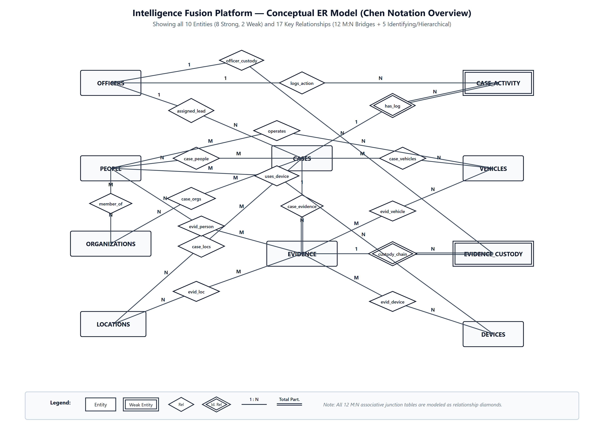
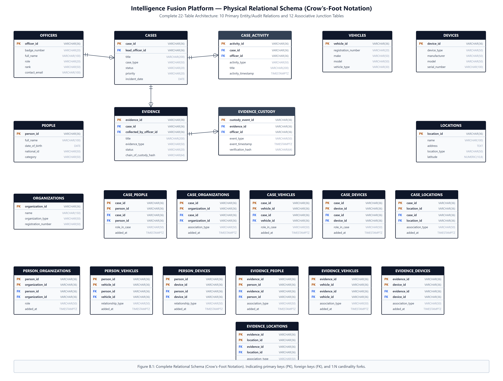
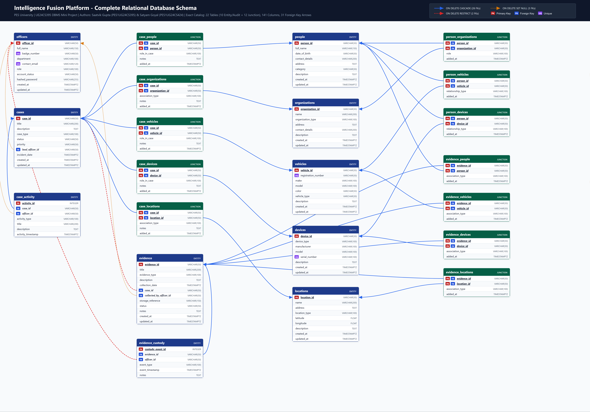

# Intelligence Fusion Platform — Entity-Relationship (ER) Diagram

**Course:** Database Management Systems Mini Project (UE24CS395/DBMS)  
**Authors:** Saatvik Gupta (`PES1UG24CS395`) & Satyam Goyal (`PES1UG24CS424`)  
**Domain:** Multi-Agency Investigation & Intelligence Fusion Platform  
**Architecture:** 22 Normalized Relational Tables (10 Core Entities + 12 Junction Tables) in 3NF/BCNF + MongoDB Unstructured Repository

---

## Visual Diagram Deliverables (Academic Publication Suite)

### 1. Conceptual ER Diagram (Chen Notation Overview)

*Figure 1: Complete Chen Notation Conceptual Model displaying all 10 entities (8 strong, 2 weak), 12 M:N associative relationships, identifying relationships with total participation (double lines), and primary key/cardinality specifications.*

### 2. Physical Relational Schema (Crow's-Foot Notation Overview)

*Figure 2: Complete Crow's-Foot Physical Schema covering all 22 tables with typed Primary Keys (PK), Foreign Keys (FK), nullability, and 1:N cardinality forks.*

### 3. Relational Schema Diagram (Port-to-Port Attribute Foreign Key Mappings)

*Figure 3: Complete 22-Table Relational Schema Diagram extracted directly from `schema.json`. Every foreign key arrow originates at the exact source foreign key attribute row port and terminates with an arrowhead at the referenced target primary key attribute row port (31 foreign key connector arrows total, color-coded by ON DELETE behavior).*

---

## 1. Complete System Entity-Relationship Diagram (Mermaid ER)

```mermaid
erDiagram
    OFFICERS ||--o{ CASES : "leads investigation"
    OFFICERS ||--o{ EVIDENCE : "collects"
    OFFICERS ||--o{ EVIDENCE_CUSTODY : "custody events"
    OFFICERS ||--o{ CASE_ACTIVITY : "performs action"

    CASES ||--o{ CASE_ACTIVITY : "audits state changes"
    CASES ||--o{ EVIDENCE : "contains exhibits"
    
    CASES ||--|{ CASE_PEOPLE : "associates"
    PEOPLE ||--|{ CASE_PEOPLE : "involved in"

    CASES ||--|{ CASE_ORGANIZATIONS : "targets / investigates"
    ORGANIZATIONS ||--|{ CASE_ORGANIZATIONS : "linked to"

    CASES ||--|{ CASE_VEHICLES : "impounds / tracks"
    VEHICLES ||--|{ CASE_VEHICLES : "implicated in"

    CASES ||--|{ CASE_DEVICES : "seizes / analyzes"
    DEVICES ||--|{ CASE_DEVICES : "linked to"

    CASES ||--|{ CASE_LOCATIONS : "maps crime scenes"
    LOCATIONS ||--|{ CASE_LOCATIONS : "geolocated in"

    EVIDENCE ||--o{ EVIDENCE_CUSTODY : "tracked by"
    EVIDENCE ||--|{ EVIDENCE_PEOPLE : "recovered from"
    PEOPLE ||--|{ EVIDENCE_PEOPLE : "associated with"

    EVIDENCE ||--|{ EVIDENCE_VEHICLES : "recovered from"
    VEHICLES ||--|{ EVIDENCE_VEHICLES : "associated with"

    EVIDENCE ||--|{ EVIDENCE_DEVICES : "digital copy of"
    DEVICES ||--|{ EVIDENCE_DEVICES : "hardware exhibit"

    EVIDENCE ||--|{ EVIDENCE_LOCATIONS : "found at"
    LOCATIONS ||--|{ EVIDENCE_LOCATIONS : "scene of collection"

    PEOPLE ||--|{ PERSON_ORGANIZATIONS : "employed by / member"
    ORGANIZATIONS ||--|{ PERSON_ORGANIZATIONS : "affiliates"

    PEOPLE ||--|{ PERSON_VEHICLES : "owns / drives"
    VEHICLES ||--|{ PERSON_VEHICLES : "registered to"

    PEOPLE ||--|{ PERSON_DEVICES : "operates / carries"
    DEVICES ||--|{ PERSON_DEVICES : "belongs to"

    %% Cross-Database Polyglot Linking (Relational to Document Store)
    CASES ||..o{ MONGODB_INVESTIGATION_DOCUMENTS : "references (case_id)"
    PEOPLE ||..o{ MONGODB_INVESTIGATION_DOCUMENTS : "polymorphic ref (entity_id)"
    DEVICES ||..o{ MONGODB_INVESTIGATION_DOCUMENTS : "polymorphic ref (entity_id)"

    OFFICERS {
        string officer_id PK "OFF-XXX"
        string full_name
        string badge_number UK
        string department
        string contact_email UK
        string role "ADMIN | INVESTIGATOR"
        string account_status "Active | Suspended"
        string hashed_password
        timestamp created_at
        timestamp updated_at
    }

    CASES {
        string case_id PK "CASE-YYYY-XXX"
        string title
        text description
        string case_type
        string status "Open | Under Investigation | On Hold | Closed"
        string priority "Low | Medium | High | Critical"
        string lead_officer_id FK "REFERENCES officers(officer_id)"
        timestamp incident_date
        timestamp created_at
        timestamp updated_at
    }

    PEOPLE {
        string person_id PK "PER-XXX"
        string full_name
        string date_of_birth
        string contact_details
        text address
        string category "Witness | Reporting Party | Subject | Other"
        text description
        timestamp created_at
        timestamp updated_at
    }

    ORGANIZATIONS {
        string organization_id PK "ORG-XXX"
        string name
        string organization_type
        text address
        string contact_details
        text description
        timestamp created_at
        timestamp updated_at
    }

    VEHICLES {
        string vehicle_id PK "VEH-XXX"
        string registration_number UK
        string make
        string model
        string color
        string vehicle_type
        text description
        timestamp created_at
        timestamp updated_at
    }

    DEVICES {
        string device_id PK "DEV-XXX"
        string device_type
        string manufacturer
        string model
        string serial_number UK
        text description
        timestamp created_at
        timestamp updated_at
    }

    LOCATIONS {
        string location_id PK "LOC-XXX"
        string name
        text address
        string location_type
        float latitude
        float longitude
        text description
        timestamp created_at
        timestamp updated_at
    }

    EVIDENCE {
        string evidence_id PK "EVD-XXX"
        string title
        string evidence_type "Physical | Digital | Forensic | Documentary"
        text description
        timestamp collection_date
        string case_id FK "REFERENCES cases(case_id)"
        string collected_by_officer_id FK "REFERENCES officers(officer_id)"
        string storage_reference
        string status
        text notes
        timestamp created_at
        timestamp updated_at
    }

    EVIDENCE_CUSTODY {
        int custody_event_id PK
        string evidence_id FK "REFERENCES evidence(evidence_id)"
        string officer_id FK "REFERENCES officers(officer_id)"
        string event_type
        timestamp event_timestamp
        text notes
    }

    CASE_ACTIVITY {
        int activity_id PK
        string case_id FK "REFERENCES cases(case_id)"
        string officer_id FK "REFERENCES officers(officer_id)"
        string activity_type
        string title
        text description
        timestamp activity_timestamp
    }

    %% Junction Tables
    CASE_PEOPLE {
        string case_id PK,FK
        string person_id PK,FK
        string role_in_case
        text notes
        timestamp added_at
    }

    CASE_ORGANIZATIONS {
        string case_id PK,FK
        string organization_id PK,FK
        string association_type
        text notes
        timestamp added_at
    }

    CASE_VEHICLES {
        string case_id PK,FK
        string vehicle_id PK,FK
        string role_in_case
        text notes
        timestamp added_at
    }

    CASE_DEVICES {
        string case_id PK,FK
        string device_id PK,FK
        string role_in_case
        text notes
        timestamp added_at
    }

    CASE_LOCATIONS {
        string case_id PK,FK
        string location_id PK,FK
        string association_type
        text notes
        timestamp added_at
    }

    PERSON_ORGANIZATIONS {
        string person_id PK,FK
        string organization_id PK,FK
        string role
        timestamp added_at
    }

    PERSON_VEHICLES {
        string person_id PK,FK
        string vehicle_id PK,FK
        string relationship_type
        timestamp added_at
    }

    PERSON_DEVICES {
        string person_id PK,FK
        string device_id PK,FK
        string relationship_type
        timestamp added_at
    }

    EVIDENCE_PEOPLE {
        string evidence_id PK,FK
        string person_id PK,FK
        string association_type
        timestamp added_at
    }

    EVIDENCE_VEHICLES {
        string evidence_id PK,FK
        string vehicle_id PK,FK
        string association_type
        timestamp added_at
    }

    EVIDENCE_DEVICES {
        string evidence_id PK,FK
        string device_id PK,FK
        string association_type
        timestamp added_at
    }

    EVIDENCE_LOCATIONS {
        string evidence_id PK,FK
        string location_id PK,FK
        string association_type
        timestamp added_at
    }
```

---

## 2. Relational Schema Structure Summary (22 Tables)

| Category | Table Name | Primary Key | Key Foreign Keys & Integrity Rules |
| :--- | :--- | :--- | :--- |
| **Core Entity** | `officers` | `officer_id` (VARCHAR) | `badge_number` (UNIQUE), `contact_email` (UNIQUE), `role` (ADMIN / INVESTIGATOR) |
| **Core Entity** | `cases` | `case_id` (VARCHAR) | `lead_officer_id` -> `officers` (ON DELETE SET NULL); Check constraints on status & priority |
| **Core Entity** | `people` | `person_id` (VARCHAR) | Check constraint on category (`Witness`, `Reporting Party`, `Subject`, `Other`) |
| **Core Entity** | `organizations`| `organization_id` (VARCHAR)| Commercial, governmental, and syndicate entities |
| **Core Entity** | `vehicles` | `vehicle_id` (VARCHAR) | `registration_number` (UNIQUE) |
| **Core Entity** | `devices` | `device_id` (VARCHAR) | `serial_number` (UNIQUE) |
| **Core Entity** | `locations` | `location_id` (VARCHAR)| Latitude, longitude, physical address |
| **Core Entity** | `evidence` | `evidence_id` (VARCHAR)| `case_id` -> `cases` (**ON DELETE RESTRICT**), `collected_by_officer_id` -> `officers` |
| **Audit Log** | `evidence_custody` | `custody_event_id` (INT AUTO)| `evidence_id` -> `evidence` (CASCADE), `officer_id` -> `officers` (RESTRICT) |
| **Audit Log** | `case_activity` | `activity_id` (INT AUTO) | `case_id` -> `cases` (CASCADE), `officer_id` -> `officers` (SET NULL) |
| **Junction (M:N)** | `case_people` | `(case_id, person_id)` | CASCADE on case_id & person_id |
| **Junction (M:N)** | `case_organizations` | `(case_id, organization_id)` | CASCADE on case_id & organization_id |
| **Junction (M:N)** | `case_vehicles` | `(case_id, vehicle_id)` | CASCADE on case_id & vehicle_id |
| **Junction (M:N)** | `case_devices` | `(case_id, device_id)` | CASCADE on case_id & device_id |
| **Junction (M:N)** | `case_locations` | `(case_id, location_id)` | CASCADE on case_id & location_id |
| **Junction (M:N)** | `person_organizations` | `(person_id, organization_id)` | CASCADE on person_id & organization_id |
| **Junction (M:N)** | `person_vehicles` | `(person_id, vehicle_id)` | CASCADE on person_id & vehicle_id |
| **Junction (M:N)** | `person_devices` | `(person_id, device_id)` | CASCADE on person_id & device_id |
| **Junction (M:N)** | `evidence_people` | `(evidence_id, person_id)` | CASCADE on evidence_id & person_id |
| **Junction (M:N)** | `evidence_vehicles` | `(evidence_id, vehicle_id)` | CASCADE on evidence_id & vehicle_id |
| **Junction (M:N)** | `evidence_devices` | `(evidence_id, device_id)` | CASCADE on evidence_id & device_id |
| **Junction (M:N)** | `evidence_locations` | `(evidence_id, location_id)` | CASCADE on evidence_id & location_id |
